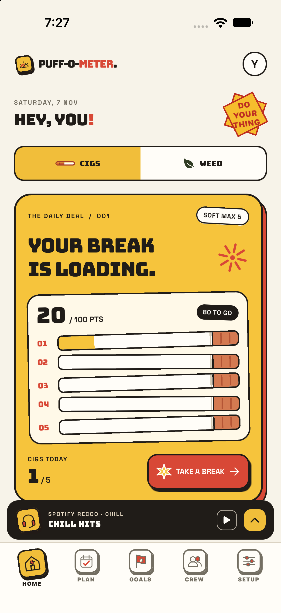

# Puff-o-meter

An iOS-only task, break, and music tracker. Finish tasks to fill a meter, plan tomorrow or a whole week, set goals, and share a simple task-versus-cigarette count with friends. The optional green zone has a slower meter and can be limited to weekends.

## Run

1. Install Node.js 22.13 or newer, pnpm, Xcode, and CocoaPods.
2. Run `pnpm install` and copy `.env.example` to `.env`.
3. Run `pnpm exec expo prebuild --platform ios --no-install`, then `cd ios && pod install`.
4. Open `ios/Puffometer.xcworkspace` in Xcode, choose your Apple team and iPhone, then build and run.

The bundle ID stays `com.puffearn.app` so updates preserve data from the original installation. The iOS 27 scene lifecycle fix lives in `plugins/withIos27Scenes.js` and is applied on every prebuild.

## Google login and cloud data

See [supabase/README.md](supabase/README.md). Supabase's free plan provides Postgres and Auth. The app keeps a local copy for offline use and syncs tasks, goals, settings, and smoke logs to a private row after sign-in. Friend codes expose only daily totals to connected friends. The Supabase publishable key is safe for the client; never add a service role key or Google client secret to this repository.

## Spotify login

Create a Spotify developer app with iOS bundle ID `com.puffearn.app` and redirect URI `puff-o-meter-spotify://callback`. Copy its **client ID** to `EXPO_PUBLIC_SPOTIFY_CLIENT_ID` in `.env`; do not put the client secret in the app. Rebuild iOS. Open the music bar and tap **Log in**. Sign-in uses Spotify's authorization-code PKCE flow, stores tokens in iOS Keychain, and shows your top tracks. The mood playlists remain available without an account. Full playback depends on Spotify's embed and account restrictions; tracks can also open in Spotify.

Spotify's current Development Mode requires the app owner to have Premium and limits new apps to five approved users. A public release needs Spotify's extended quota approval; the in-app login can be tested with approved accounts before then.

## Product notes

- A task awards its chosen points when completed. A cigarette uses 100 points by default, with a soft daily max of five.
- The green meter accrues at one fifth of task points and needs 400 points for a session by default. Weekend-only access starts on.
- A no-guilt break can be logged without spending points. The daily count still reflects it.
- The music bar starts paused and offers Chill, Focus, Social, and Reset playlists.
